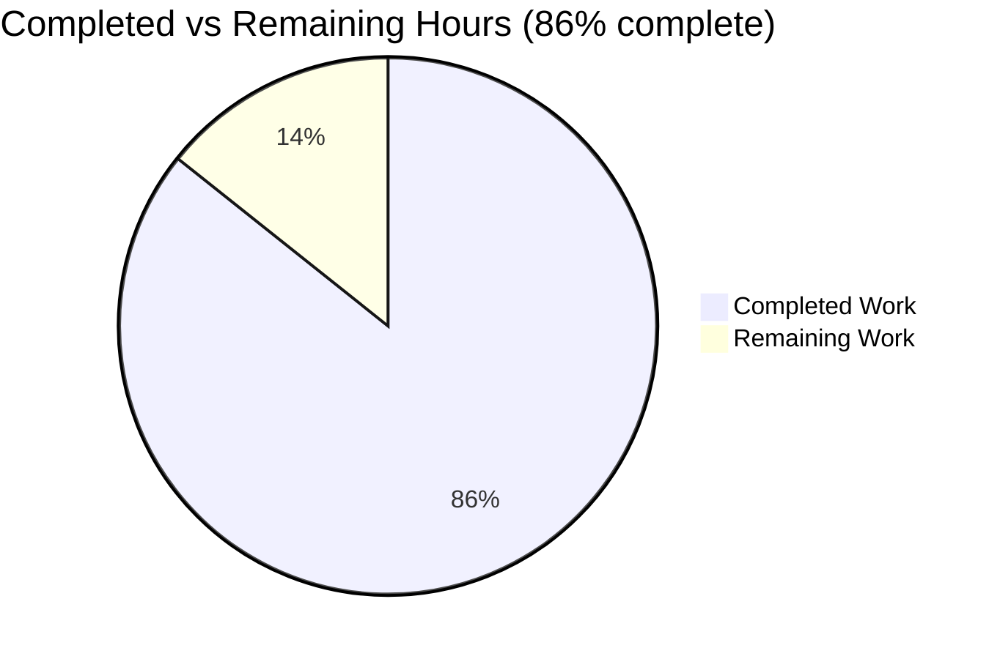
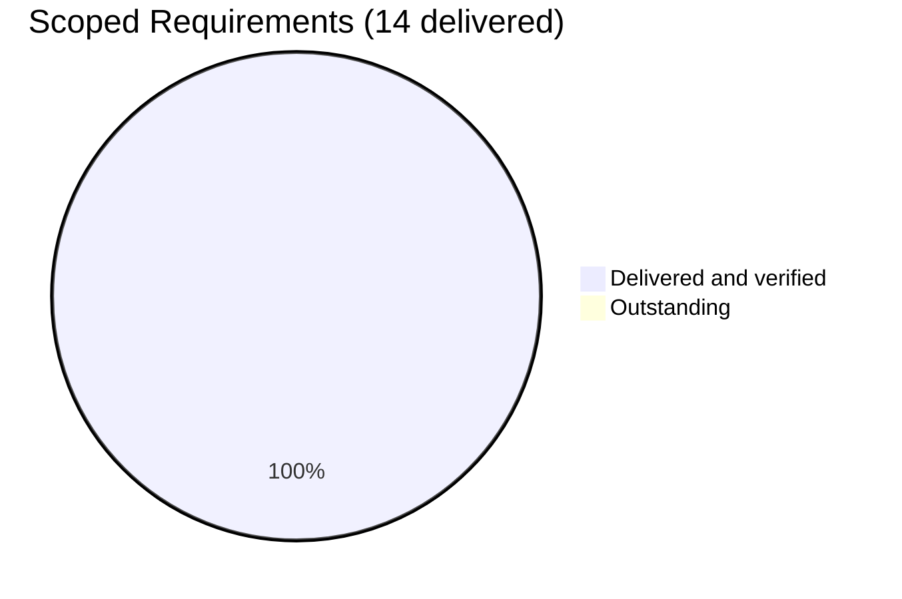

# 1. Executive Summary

## 1.1 Project Overview

A single-purpose Node.js command-line program whose only behaviour is to print the exact string `Welcome to Blitzy` to standard output with no formatting, delivered as two root files: `index.js` (two lines) and `README.md` (four lines). It is deliberately the smallest program that satisfies the request rather than a production service — no manifest, dependency, build step, configuration or port.

## 1.2 Completion Status

Completion is hours-based and scoped to the agreed requirements: **6 completed hours ÷ (6 completed + 1 remaining) × 100 = 85.71%, expressed as 86%**.



Brand colours: Completed = Dark Blue (#5B39F3); Remaining = White (#FFFFFF).

| Metric | Hours |
|--------|-------|
| Total Hours | 7 |
| Completed Hours (AI + Manual) | 6 |
| Remaining Hours | 1 |

## 1.3 Key Accomplishments

- ✅ Prints exactly `Welcome to Blitzy` (18 bytes with the newline), exit status 0, nothing on standard error (`index.js:2`).
- ✅ Runs install-free and dependency-free: no manifest, lockfile, `node_modules`, dependency or build step.
- ✅ Output invariant under invocation form, empty environment, hostile arguments, closed and piped streams, colour forcing, repetition and concurrency.
- ✅ `README.md` is four lines inside its five-line budget, and its command and quoted string match the program.
- ✅ Two files changed in ten lines (`770ede1`, `8db8eef`), with the exclusion boundary intact: no test suite, dependency, CI, container, extra document or tooling configuration.

## 1.4 Critical Unresolved Issues

**Open items: 7 of 14 scoped requirements** carry an accepted caveat or a documented divergence; the other 7 carry none. None blocks release — each is a presentation, invocation or verification-mechanism constraint recorded with its reason. The groups below sum to 7.

| Issue | Impact | Owner | ETA |
|-------|--------|-------|-----|
| README presentation and invocation clarity — 2 items: lines 3–4 render as one paragraph; the run command is root-relative and the program file carries no executable bit | A reader skimming rendered markdown can miss the command; `./index.js` or a relative invocation from elsewhere fails | Repository owner | 1 h (Medium) |
| The runtime statement carries no version floor — 1 item | Behaviour is verified only on the Node release used here; an older major is unverified | Repository owner | Release checklist, no code change |
| No committed check guards the printed literal and the documented string — 1 item | A future edit to the printed line can silently stale the documentation | Repository owner | Release checklist, no code change |
| Standard-output write failures and stdin handling follow the runtime's default behaviour — 1 item | A caller piping a large payload in can observe a broken pipe on its own side | Repository owner | None required (by design) |
| Comment and change-description constraints — 2 items: the one-line JSDoc summary documents an expression statement; the documentation file replaced a pre-existing two-line placeholder | No tooling can attach the comment as a declaration comment; the change must be read as one file added and one replaced, not two added | Repository owner | None required |

## 1.5 Access Issues

No access issues identified: no permission beyond read access to two files, no service credential, no third-party API access and no network connection is involved.

## 1.6 Recommended Next Steps

1. [Medium] Decide the `README.md` presentation and invocation wording (1 h): the run command on its own line, the invoking directory stated.
2. [Medium] Confirm the deployment shell's Node release and record the exercised version in the release notes.
3. [Low] Re-run the acceptance gate before hand-off: `node --check index.js` plus the byte-exact output comparison.
4. [Low] Exclude the checkout's empty, untracked scaffold directory from any packaging step.
5. [Low] Keep the two-file scope: a test suite, manifest or CI configuration would breach the agreed exclusions.

# 2. Project Hours Breakdown

## 2.1 Completed Work Detail

Every component traces to a requirement of the agreed scope; the hours are implementation effort plus the verification share such a deliverable requires, since its acceptance criterion is runtime output.

| Component | Hours | Description |
|-----------|-------|-------------|
| `index.js` — welcome-message program | 2 | The two-line program: the mandated one-line JSDoc summary above a single, unformatted `console.log` of the literal, with no import, no input surface, no exit handling and no second statement. Verified parse-clean and byte-exact against the required contents. |
| `README.md` — run and dependency documentation | 1 | Four lines inside the five-line budget: the heading, the dependency and runtime statement, and the run command, with none of the excluded sections. Claims checked against the tree and the program. |
| Output and invocation contract verification | 2 | The byte-exact standard-output comparison, exit status, empty standard error, and invariance across invocation forms, environment, streams, terminal, repetition, concurrency and adversarial arguments. |
| Scope and structural discipline | 1 | Holding the deliverable to two files and a ten-line diff, and verifying the absence of every excluded artefact class item by item. |
| **Total** | **6** | Matches Completed Hours in Section 1.2. |

## 2.2 Remaining Work Detail

| Category | Hours | Priority |
|----------|-------|----------|
| Documentation presentation and invocation clarity in `README.md` — render the run command on its own line and state the invoking directory (this revisits content currently frozen as the acceptance value) | 1 | Medium |
| **Total** | **1** | Matches Remaining Hours in Section 1.2 |

Items that require no engineering hours, recorded so nothing is silently dropped: confirming the deployment shell runs a Node release the program has been exercised under; keeping the byte-exact acceptance comparison in the release checklist, since no committed check guards the printed literal and the documented string; excluding the empty untracked scaffold directory from packaging; and leaving the runtime's default behaviour for standard-output write failures, the one-line JSDoc summary on an expression statement, and the documentation file's replacement of the pre-existing placeholder exactly as they stand, each accepted with its reason recorded in Section 5.2.

## 2.3 Total Project Hours

| Measure | Value |
|---------|-------|
| Completed Hours (Section 2.1) | 6 |
| Remaining Hours (Section 2.2) | 1 |
| Total Project Hours | 7 |

**Completion calculation:** 6 ÷ (6 + 1) × 100 = 85.71%, expressed as **86%**. The share outstanding is optional documentation presentation work rather than missing capability: all fourteen scoped requirements are delivered and verified.

# 3. Test Results

The checks below are the ones executed against the delivered files and their observed results: **49 checks executed, 49 passed, 0 failed**. The deliverable ships no test framework, no coverage tool and no linter — none can exist without a package manifest, which the agreed scope excludes — so each row states the framework actually used.

| Area / Category | Framework | Tests | Passed | Failed | Coverage | What This Proves |
|-----------------|-----------|-------|--------|--------|----------|------------------|
| Program source form and content (`index.js`) | Node.js parser (`node --check`) plus byte-exact file comparison | 11 | 11 | 0 | n/a — no instrumentation | The shipped program parses and is exactly the two required lines: single-line JSDoc summary, one print call, one statement, no import, no input surface |
| Run-instruction documentation (`README.md`) | Byte-exact content comparison plus line-budget and section checks | 5 | 5 | 0 | n/a — no instrumentation | The documentation is exactly the four required lines, inside its budget, with no excluded section |
| Program output contract | Runtime capture compared with `cmp` and `wc` | 6 | 6 | 0 | n/a — no instrumentation | One unformatted 18-byte line, exit status 0 and nothing on standard error |
| Invocation, environment and stream invariance | Runtime checks over arguments, empty environment, working directory, streams, terminal and colour-forcing variables | 14 | 14 | 0 | n/a — no instrumentation | The printed output cannot be influenced by how, where or with what the program is invoked |
| Repetition and concurrency determinism | 10 sequential runs plus 10 simultaneous runs compared by hash and exit code | 4 | 4 | 0 | n/a — no instrumentation | Repeated and concurrent runs are identical, deterministic and residue-free |
| Repository shape, diff minimality and exclusion boundary | `git diff`/`git ls-files` plus filesystem sweeps | 8 | 8 | 0 | n/a — no instrumentation | Exactly the two named files changed, the diff is minimal, and none of the excluded artefacts exists |
| Placeholder and stub sweep (both files) | Text search over the deliverable | 1 | 1 | 0 | n/a — no instrumentation | No TODO, FIXME or placeholder marker remains anywhere in the deliverable |

**Not Covered**

- **Coverage is not measured.** No instrumentation framework ships with the deliverable and none may be added without a package manifest, so statement and branch coverage figures do not exist.
- **No lint, format or type-check gate and no CI pipeline exist**, and none can be created within the agreed exclusions; the syntax check is the only static gate.
- **No automated regression check is committed.** The comparison between the printed string and the string the documentation quotes is a manual gate, so a future edit to that line is not caught automatically.
- **Error and failure paths are not exercised** beyond a closed standard output and a closed downstream pipe: the program accepts no input, performs no validation and has no failure path by design.
- **Only one runtime release is exercised.** All results above are from the Node release installed here (v22.23.3); other major versions are untested.
- **Concurrency is exercised to ten simultaneous invocations**; higher contention is untested, though the program holds no shared state, opens nothing and creates nothing.
- **No user interface, document or browser surface is tested**, because the program renders no document; a human should re-run the byte-exact gate after any edit to the printed line or the documentation.

# 4. Runtime Validation & UI Verification

The deliverable exposes one runtime surface — a command-line invocation that prints a single line — and it was driven end to end, including under conditions that would reveal hidden dependencies.

- ✅ **Start, print and exit** — `node index.js` from the checkout root returns status 0 immediately, with no lingering process and no open handle.
- ✅ **Output bytes** — exactly 18 bytes, `Welcome to Blitzy` plus one newline, byte-identical to the acceptance value through a pipe and through a file.
- ✅ **Unformatted output** — zero escape, ANSI, carriage-return or non-ASCII bytes and exactly one line, including under `FORCE_COLOR=3`, `CLICOLOR_FORCE=1` and `TERM=xterm-256color`.
- ✅ **Standard error** — empty on every run.
- ✅ **Invocation forms** — dotted path, absolute path from a foreign working directory, and a symlinked copy all reproduce the identical output.
- ✅ **Empty environment** — identical output under `env -i`, so no environment variable or configuration file influences the string.
- ✅ **Streams and arguments** — extra and hostile arguments, closed standard input, piped, redirected and closed standard output all leave the output unchanged, with a closed output still exiting 0 and writing nothing.
- ✅ **Repetition and concurrency** — ten sequential and ten simultaneous runs produced one distinct output, exit 0 throughout, and no interleaved or truncated bytes.
- ✅ **Repository side effects** — the working tree, file inventory and content hashes are unchanged after every flow, so the program creates, modifies and reads nothing.
- ⚠ **Terminal-attached capture** — a capture through a pseudo-terminal measures 19 bytes rather than 18 because the terminal translates the newline it receives; the program's own stream is 18 bytes, confirmed through a pipe and a file. Nothing failed in any flow.

**Never exercised at runtime, because the surface does not exist:** no server, port, route or listener; no external integration, socket or DNS activity; no database, cache or queue; no data model or schema; no error or validation path; no user interface, document or browser rendering; and no Node release other than v22.23.3. The single integration point is the shell invocation the documentation states, which was extracted and executed literally and reproduces the documented string.

# 5. Compliance & Quality Review

## 5.1 Compliance Matrix

| # | Deliverable / Requirement | Status | Progress | Evidence |
|---|---------------------------|--------|----------|----------|
| 1 | `index.js` contents exactly as specified (2 lines, 76 bytes) | ✅ PASS | 100% | Byte-exact comparison returns identical; hash `470b5dbd…04bfc`; parse check exits 0 |
| 2 | Printed output — exact string, unformatted | ✅ PASS | 100% | 18-byte standard output, zero escape/ANSI bytes, one line, matching the acceptance value |
| 3 | Invocation contract — `node index.js`, no install step | ✅ PASS | 100% | Observed from the checkout root and by absolute path from elsewhere; no manifest means no install step exists |
| 4 | `README.md` contents and five-line budget | ✅ PASS | 100% | Four lines, one hunk, byte-exact; no excluded section; hash `55af86c4…d360` |
| 5 | Documentation claims resolve against the program and the tree | ✅ PASS | 100% | The documented command was extracted and executed literally and reproduces the quoted string; the dependency claim holds under an empty environment and with the program file alone |
| 6 | Smallest possible diff, no unrelated edits | ✅ PASS | 100% | Ten changed lines across two files; no rename, copy or other touched path |
| 7 | Deliverable limited to the two named files | ✅ PASS | 100% | Working tree and tracked file list each hold exactly `index.js` and `README.md` |
| 8 | Exclusion boundary intact | ✅ PASS | 100% | No test suite, lockfile, dependency, manifest, CI configuration, container, deployment automation, extra document or tooling configuration exists |
| 9 | Security baseline — no input surface, network use, credential or stored data | ✅ PASS | 100% | No argument, environment, stdin or file input; no socket, DNS or subprocess; the only output is a fixed public string |
| 10 | Error handling, hardening and configuration absent as required | ✅ PASS | 100% | No handler, no exit-code handling, no environment reading, no logging point, one statement |
| 11 | Comment form — single-line JSDoc summary | ✅ PASS | 100% | Line 1 matches the single-line summary form with no tags; it is the file's only comment |
| 12 | Build, run and verification reproducible | ✅ PASS | 100% | Every command in Section 9 was executed and its output observed; the tree is unchanged by each |

## 5.2 AAP & Rule Divergences and Gaps

No user rules were supplied for this work, so no rule-governed divergence exists; every entry below is a departure from the agreed plan's own wording, or a constraint accepted rather than changed. Each is a fact about this codebase, not a defect: the delivered behaviour is correct wherever it has an observable outcome.

| # | What the AAP/Rule Required | What Was Delivered Instead | Why It Diverged | Impact | Remediation |
|---|----------------------------|----------------------------|-----------------|--------|-------------|
| D1 | The checkout root holds no file, so both deliverables would be created (0.1.1, 0.2.2, 0.6.1; map 0.8.1) | `README.md` was already tracked as a two-line placeholder and was replaced wholesale — one hunk, 4 insertions, 2 deletions, no surviving line (commit `8db8eef`) | The checkout carried a scaffolded root README, so the file the map names could only be delivered by replacing it | None on content or behaviour; it changes how the change is described — one file added, one replaced | None required; read the diff against the baseline commit as `M README.md`, `A index.js` |
| D2 | The four documentation lines are the final content, under five lines, with no added section (FR-5, 0.8.1) | Exactly those four lines, in which lines 3 and 4 are consecutive, so a renderer joins them into one paragraph (`README.md:3-4`) | The four lines are the frozen acceptance value; a blank line would break the byte-exact match and enlarge the protected diff | Presentation only — the run command is present and correct, just not on its own rendered line | Deliberate decision to revisit the frozen content (1 h, Section 2.2); no functional work |
| D3 | Run the program with `node index.js` (0.6.2) in a two-line file (FR-3, 0.5.1) | The instruction is relative to the checkout root without stating so, and the file has no shebang and mode 100644 (`README.md:4`, `index.js:1`) | Both the documentation content and the two-line form are fixed; a shebang would make the program three lines and a directory note would add a line | `./index.js` fails with "Permission denied" and a relative command from elsewhere raises "Cannot find module"; the documented command from the checkout root works | Fold into the 1 h documentation decision, or widen the invocation contract in a later change |
| D4 | Accurate install and run instructions for the repository as it stands (0.2.1), against a toolchain with minimum runtime versions | `README.md:3` states "requires Node.js" with no version floor, and no manifest declares one | The documentation content is frozen and a manifest is excluded, so neither a version note nor an `engines` field may be added | No false claim — no version is asserted and the program uses only `console.log` — but older runtime majors are unverified | Confirm the deployed runtime in the release checklist; a documented floor requires widening scope |
| D5 | The whole body is one print statement, with no error handling, logging point or hardening (0.11.1; exclusions 0.7.2) | No handler for standard-output write failures (EPIPE, closed output, ENOSPC); those follow the runtime's default, and the program exits without reading standard input (`index.js:2`) | A handler would be the hardening and the extra statements the agreed scope forbids | A caller streaming a large payload into the program can see a broken pipe on its own side; probed runs still exited 0 with empty error output and no partial line | None required; record it for any future wrapper |
| D6 | A one-line `/** … */` summary and nothing more (FR-4, 0.11.1) | The summary sits above a top-level expression statement, so no documentation tool can attach it as a declaration comment (`index.js:1`) | The required comment form and the two-line file are both fixed, leaving no declaration for it to document | Informational only; the comment accurately describes the statement beneath it | None required |
| D7 | The user's instruction: "Do not add a test suite, test files, a lockfile, or any dependency", with the smallest possible diff and no unrelated edits | **Sanctioned.** No test suite, test file, linter, coverage tool or CI gate exists — none can exist without a manifest; the checks used while building were kept outside the checkout and not committed, and each file was built on its own | The user's own instruction excludes them, so adding any of them would breach a higher-ranked requirement | Nothing in the repository guards the printed literal or the documented string against a future edit; acceptance comparison remains a manual gate | None within the agreed scope; closing it would require a scope change |

**D1 — how the second file should be read.** The delivered documentation file is a replacement, not a creation. The checkout was created with a two-line root README naming the workspace and the tool that made it, and that file was already tracked at the baseline commit before any work landed. Comparing the baseline with the current head shows `M README.md` alongside `A index.js`; the two placeholder lines survive on no line of the file, and the replacement occupies one hunk with 4 insertions and 2 deletions. Nothing in the delivered content or behaviour is affected — `README.md` is byte-identical to the four lines the plan fixes — but any description of this change that calls it two new files misstates the history a reader will see in their own repository.

**D2 — the run command renders inside a paragraph.** Markdown treats the dependency sentence and the run command as one paragraph because no blank line separates them, so a reader viewing rendered output sees the command inline rather than on its own line. Inserting the missing blank line is the only settlement, and it would depart from content that is frozen as the byte-exact acceptance value for this change while also enlarging the diff the same scope protects. The command itself is present, correct, and was executed literally to confirm it reproduces exactly the string the line above quotes. This is a presentation decision for the repository owner, costing 1 h if they choose to revisit the accepted content.

**D3 — the run command is root-relative and the file is not executable.** The documented command is written relative to the checkout root without saying so, and `index.js` is mode 100644 with no shebang, so invoking the file directly fails with `/bin/bash: ./index.js: Permission denied` and running the documented command from another directory raises node's "Cannot find module". Both constraints follow from frozen content: a shebang would make the program three lines and contradict the two-line requirement, and a directory note would add a fifth line to documentation fixed at four. Running `node index.js` from the checkout root works, and an absolute path works from any directory, which is what a scripted caller should use.

**D4 — the runtime statement carries no version floor.** The documentation says the program requires Node.js and names no release. The repository cannot state one: an `engines` field lives in a package manifest, which the agreed exclusions forbid, and the four documentation lines are fixed. The code needs nothing beyond `console.log`, so no version-specific behaviour is expected, but every result in Section 3 was produced on Node v22.23.3 and an older major is unverified by construction. The practical settlement is a release-checklist step: confirm what the deployment shell runs and record the exercised version in the release notes rather than in the deliverable.

**D5 — output-error behaviour is the runtime's, not the program's.** No handler exists for a failed write to standard output — a closed output, a full device, or a reader that closes the pipe early — and the program does not read standard input, so a caller that streams a large payload in can observe a broken pipe on its own side while the program exits normally. Adding a handler would mean the error handling and the second statement the agreed scope explicitly excludes, so the behaviour stands as Node's default. Probing this area produced exit status 0, empty error output and no partial line in every case, which is the honest boundary of what was verified here.

**D6 — the mandated comment documents a statement, not a declaration.** The one-line summary is attached to a top-level expression statement, so ordinary documentation tooling cannot pick it up as a declaration comment. That follows directly from the two forms the scope fixes: a single `/** … */` line and a two-line file. The comment is accurate, describes the statement beneath it and names the same string the program prints; it is informational documentation for a human reader rather than input to a generator. No settlement exists inside the agreed scope, and none is warranted for a program of this size.

**D7 — the absent test suite is the requested state (Sanctioned).** The instruction not to add a test suite, test files, a lockfile or any dependency was followed literally, and the smallest-diff requirement meant neither file was touched to accommodate the other. The consequence is worth naming plainly: no committed check compares the printed string with the string the documentation quotes, so a future edit to `index.js:2` can silently stale `README.md:3`. Until the scope changes — a manifest and a runner would both be needed — the release checklist carries the byte-exact gate, and any human changing that line should re-run it before hand-off.

# 6. Risk Assessment

Risks below are forward-looking: what could still go wrong once this deliverable is in use.

| Risk | Category | Severity | Probability | Mitigation | Status |
|------|----------|----------|-------------|------------|--------|
| The runtime release is unpinned and results are verified on one Node version only, so an older or much newer major could behave differently | Technical | Medium | Low | Confirm what the deployment shell runs and record the exercised version in the release notes; the code uses only `console.log`, so version-specific behaviour is unlikely | Open (accepted) |
| Nothing in the repository guards the agreement between the printed literal and the string the documentation quotes; an edit to the printed line can silently stale the README | Technical | Low | Medium — the printed line is the one a maintainer is most likely to change | Keep the byte-exact acceptance gate in the release checklist: `node index.js \| cmp - <(printf 'Welcome to Blitzy\n')` | Open by design — a committed check needs a manifest and a test file the agreed scope excludes |
| A failed write to standard output (closed output, full device, early-closing reader) follows the runtime's default behaviour, and the program exits without draining standard input, so a caller piping a large payload in can see a broken pipe on its side | Operational | Low | Medium for wrapped usage | Document the behaviour for any wrapper; probes showed exit 0, empty error output and no partial line | Accepted by design |
| The run command is root-relative and the program file carries no executable bit, so `./index.js` or a relative invocation from another directory fails | Operational | Low | Medium | Document the invoking directory or widen the invocation contract in a later change; scripted callers should use an absolute path | Open (optional) |
| The run command renders inside the sentence above it, so a reader skimming rendered documentation can miss it | Operational | Low | Medium | Decide the presentation of the frozen four lines (Section 2.2) | Open (optional) |
| The checkout carries an empty, untracked scaffold directory that is not part of the deliverable | Operational | Low | Low | Exclude it from any packaging or archiving step; it holds no file and is invisible to version control | Open, no action needed in the delivered tree |

**Security.** No security risk is identified: the program consumes no input of any kind, declares no dependency, opens no socket and performs no DNS lookup, holds no credential and no stored or transmitted data, and its only output is a fixed public string. The baseline sweep for secrets, injection and traversal sinks, unsafe deserialization and cryptographic misuse returns nothing to reach, because the entire executable content is one call with a constant argument.

**Integration.** No integration risk is identified: the deliverable integrates with nothing. Its single integration point is the shell invocation the documentation states, which was extracted and executed literally and reproduces the documented string; no external service, API contract, message format or authentication is involved.

**Critical path to release.** Nothing blocks release. The path is: decide the documentation presentation and invocation wording (1 h, the only estimated work); confirm the deployment shell's Node release in the release checklist; and re-run the acceptance gate — the syntax check plus the byte-exact comparison of the run output against `Welcome to Blitzy\n` — immediately before hand-off.

# 7. Visual Project Status




Brand colours: Completed / Delivered = Dark Blue (#5B39F3); Remaining / Outstanding = White (#FFFFFF).

| Status Measure | Value |
|----------------|-------|
| Completed Hours | 6 |
| Remaining Hours | 1 |
| Total Hours | 7 |
| Completion | 86% |
| Scoped requirements delivered | 14 of 14 |
| Open items carrying an accepted caveat or divergence | 7 (none blocking release) |

**Remaining hours by category**

| Category | Hours |
|----------|-------|
| Documentation presentation and invocation clarity (`README.md`) | 1 |
| **Total** | **1** |

No other category carries remaining hours: the two-file deliverable, the run contract, the exclusion boundary and the runtime behaviour are all complete and verified.

# 8. Summary & Recommendations

**What was delivered and verified.** A zero-dependency Node.js command-line program that prints the exact string `Welcome to Blitzy` to standard output with no formatting, plus four lines of run instructions at the repository root. The program's single behaviour was exercised end to end: 18 bytes on standard output, exit status 0, empty standard error, and identical results under every invocation form, an empty environment, hostile arguments, closed and piped streams, colour-forcing variables, repetition and concurrency. The documentation's command was executed literally and reproduces the string it quotes. Forty-nine executed checks passed with no failures, the exclusion boundary was verified item by item, and no run wrote to or modified anything in the tree.

**Where the project stands.** All fourteen scoped requirements are delivered and verified, and the hours-based assessment puts the work at **86% complete** — 6 completed hours of a 7-hour total, with the outstanding hour representing one optional documentation presentation decision rather than missing capability. Fourteen of fourteen requirements are complete; seven carry an accepted caveat or a documented divergence, none of which blocks release. The two files are byte-identical to the accepted contents, and the change is a ten-line diff across exactly the two files the deliverable is defined by.

**Remaining gaps and the critical path.** There is no blocking item. The critical path is short and entirely optional: decide whether to render the run command on its own line and state the invoking directory (1 h, which revisits content frozen as the acceptance value), confirm the deployment shell's Node release in the release checklist, exclude the checkout's empty untracked scaffold directory from any packaging step, and re-run the acceptance gate immediately before hand-off. One structural property deserves emphasis: no committed check guards the agreement between the printed string and the documented string, because a test suite and a manifest are both excluded by the project's own scope, so the byte-exact comparison is the release gate a maintainer must carry.

**Production readiness.** Measured against its own stated standard, the deliverable is ready: it is deliberately the smallest program that satisfies the request, not a service, so no performance, availability, observability, configuration or hardening requirement is owed. It binds nothing, opens nothing, reads no input, holds no credential and leaves the working tree untouched; it is deterministic, re-entrant and safe under simultaneous invocation. The only accepted constraints are that the runtime version is unpinned and unverified beyond the release exercised here, that standard-output write failures follow the runtime's default behaviour, and that the two documentation-presentation caveats remain open.

**Recommendation.** Ship as delivered and keep the two-file scope: adding a manifest, a dependency or a test suite would breach the exclusions the project is defined by, and the byte-exact gate belongs in the release checklist instead. Success measures for the hand-off are: the program prints exactly `Welcome to Blitzy` and exits 0 with nothing on standard error; the deliverable set remains the two named files; and any future edit to the printed line is made together with the documentation, with the gate re-run before the change leaves the repository.

# 9. Development Guide

**System prerequisites**

- **Node.js** — the only runtime required. The program was built and exercised on Node v22.23.3 (`/usr/bin/node`); it uses nothing beyond `console.log`, so no version-specific feature is in play.
- **Git** — to obtain the checkout and inspect its history (git 2.54.0 observed here).
- Nothing else: no package manager, container runtime, database, service, browser or network access.

**Environment setup**

No environment setup is required. The repository declares no manifest, no lockfile and no dependency, so there is nothing to install, no virtual environment to create, no `node_modules`, no build step and no configuration file to populate. `cd <checkout root>` is the whole of it. The program reads no environment variable, so none needs to be set.

**Dependency installation**

None — by design. A package manager has nothing to act on: there is no `package.json`, and `index.js` contains no `require` or `import`. Installing anything would add a file the project's scope excludes.

**Application startup**

```bash
cd <checkout root>
node index.js
```

Expected: the single line `Welcome to Blitzy`, exit status 0, and nothing written to standard error.

**Verification steps**

```bash
node --check index.js                     # the file parses, no output
node index.js | wc -c                     # output size, prints 18

actual=$(mktemp); node index.js > "$actual"
printf 'Welcome to Blitzy\n' | cmp - "$actual" && echo "PASS byte-exact"

out=$(mktemp); err=$(mktemp); node index.js > "$out" 2> "$err"
echo "exit=$? stdout=$(wc -c < "$out") stderr=$(wc -c < "$err")"
echo "expected: exit=0 stdout=18 stderr=0"
```

**Example usage**

```bash
node index.js | cat                 # Welcome to Blitzy
node /path/to/checkout/index.js     # same output from any directory, via an absolute path
node index.js > welcome.txt         # redirect the single line to a file
```

The program takes no arguments and reads no input, so extra arguments, an empty environment and any standard input leave the output unchanged.

**Troubleshooting**

| Symptom | Cause | Resolution |
|---------|-------|------------|
| `./index.js: Permission denied` | The file has no shebang and is not marked executable | Invoke it through the runtime: `node index.js` |
| `Cannot find module '.../index.js'` | The documented command is relative to the checkout root and was run from elsewhere | Run it from the checkout, or pass an absolute path |
| `node: command not found` | No Node runtime on `PATH` | Install Node.js, or call an absolute path such as `/usr/bin/node index.js` |
| A terminal capture measures 19 bytes instead of 18 | The terminal translates the newline it receives | Measure through a pipe or a file; the program's own stream is 18 bytes |
| The byte-exact gate shows a difference | The printed string and the documented string have diverged | Restore the literal on the printed line or update the documentation to match, then re-run the gate |

**Operational notes.** The program opens no port, starts no service, holds no state, creates no file and reads none: it prints one line and exits. There is no log, no configuration and no health endpoint to check, because none exists by design.

# 10. Appendices

## A. Command Reference

| Command | Purpose | Expected result |
|---------|---------|-----------------|
| `node index.js` | Run the program from the checkout root | Prints `Welcome to Blitzy`; exit 0 |
| `node /abs/path/index.js` | Run it from any directory | Same output; exit 0 |
| `node --check index.js` | Syntax check on the program file | No output; success |
| `node index.js \| wc -c` | Output size | `18` |
| `actual=$(mktemp); node index.js > "$actual"; printf 'Welcome to Blitzy\n' \| cmp - "$actual"` | Byte-exact acceptance gate | `PASS byte-exact` |
| `git ls-files` | Deliverable inventory | `README.md`, `index.js` |
| `git diff --name-status ffa7b2f HEAD` | What this change did to the tree | `M README.md`, `A index.js` |
| `git diff --stat ffa7b2f HEAD` | Change size | `2 files changed, 6 insertions(+), 2 deletions(-)` |

## B. Port Reference

No port is opened, bound or listened on — by the program or by anything it uses. There is no server, route, endpoint or socket, so no port allocation or firewall change is required.

## C. Key File Locations

| Path | Role |
|------|------|
| `index.js` | The whole program: a one-line JSDoc summary above a single, unformatted `console.log` of the welcome string |
| `README.md` | The run instructions and the dependency/runtime statement |

## D. Technology Versions

| Component | Version / note |
|-----------|----------------|
| Node.js | v22.23.3 (`/usr/bin/node`) — the runtime the program was exercised on; it needs only `console.log` |
| JavaScript | Executed directly by Node; no transpile, bundle or build step |
| Module system | CommonJS by default; the file contains no `require`, `import` or `export` |
| Dependencies | None declared or loaded — no manifest, no lockfile, no `node_modules` |
| Git | 2.54.0 observed, for the checkout and its history |

## E. Environment Variable Reference

None. The program reads no environment variable and the repository holds no configuration file; output is identical under `env -i`.

## F. Developer Tools Guide

No build tool, bundler, transpiler, linter, formatter, type checker, test runner or CI pipeline is configured, and none can be added within the agreed scope, since a package manifest is excluded. The available tooling is the Node runtime (`node`, `node --check`), a byte-comparison utility (`cmp`, `wc`), and git.

## G. Glossary

| Term | Meaning |
|------|---------|
| Acceptance value | The exact contents this deliverable is measured against: the two lines of `index.js` and the four lines of `README.md` |
| Byte-exact gate | The check that compares the program's standard output with `Welcome to Blitzy\n`, byte for byte |
| Install-free | No install, build or dependency-resolution step is needed to run the program |
| ONLCR | The terminal line-discipline behaviour that turns the newline the program writes into a carriage return plus newline in a terminal capture |
| Unformatted output | Output carrying no colour, escape sequence, prefix, padding or markup — the string and the newline that ends the line |
| Zero-dependency | The dependency closure is empty: no manifest, no lockfile, no `node_modules`, and no `require` or `import` in the source |
